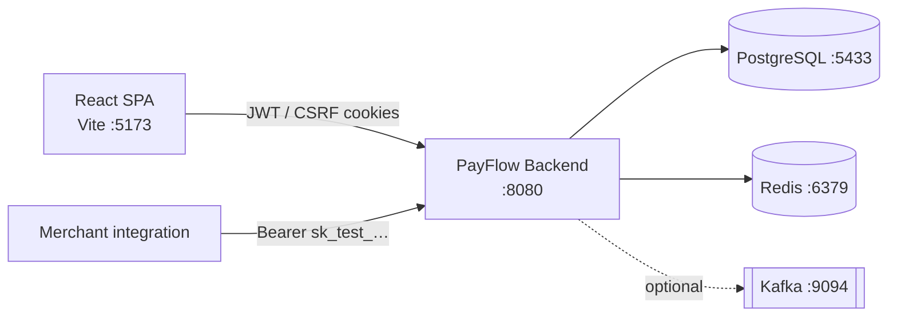
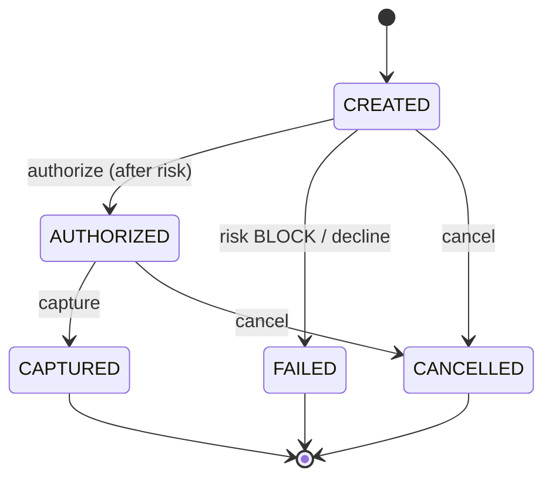
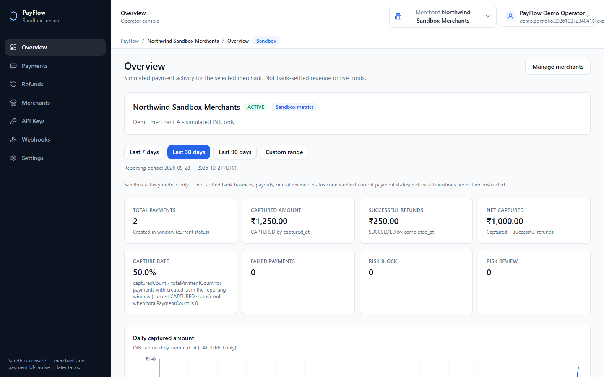
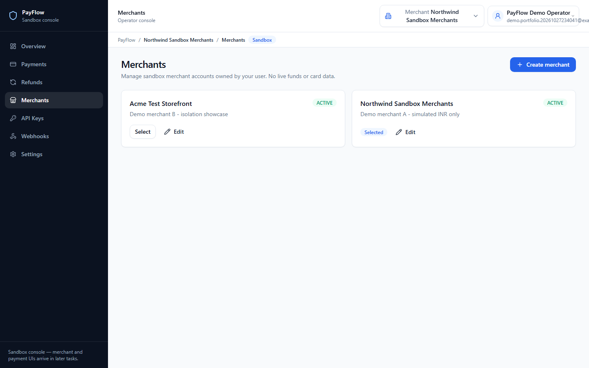
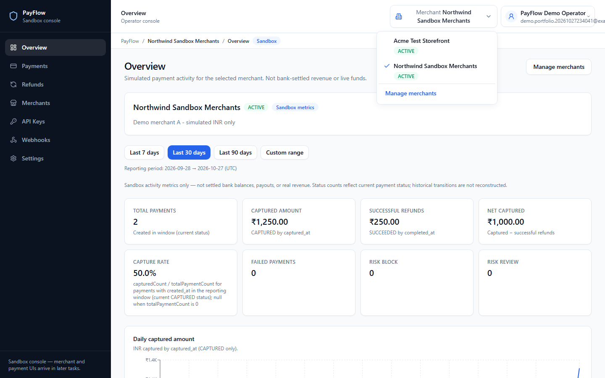
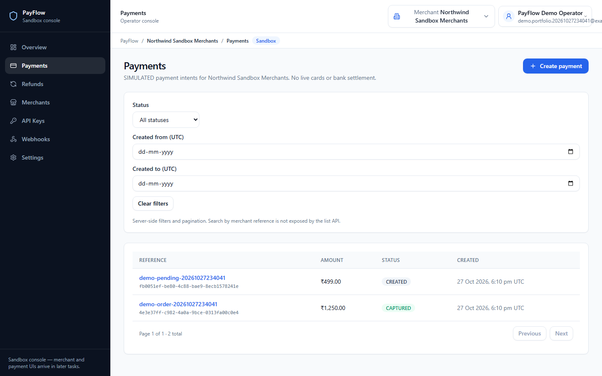
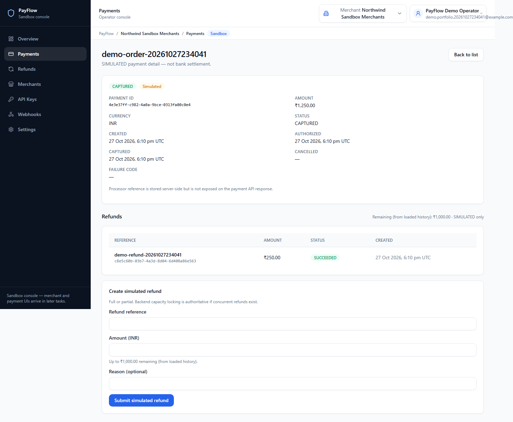
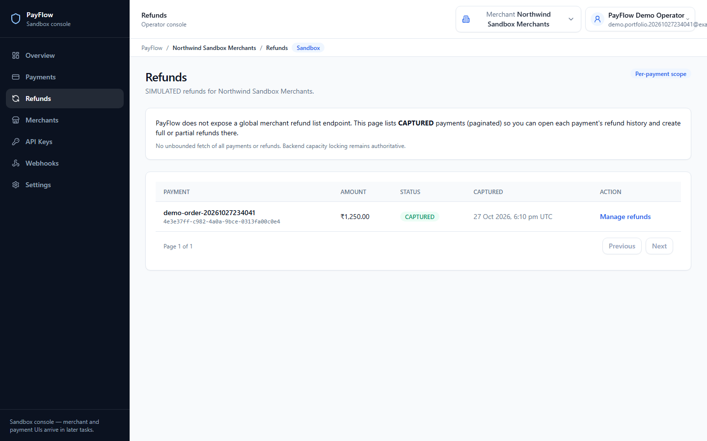
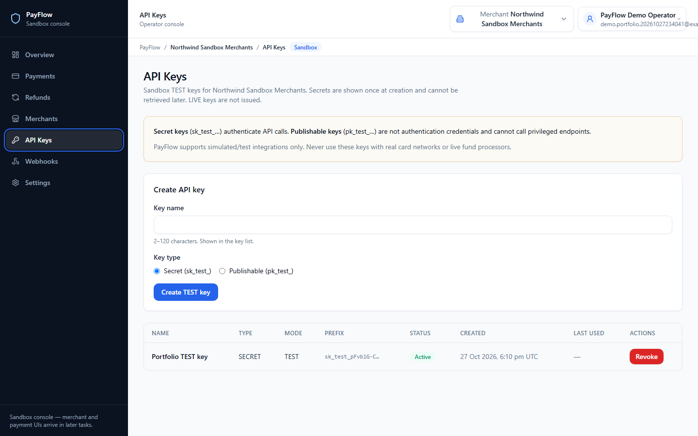
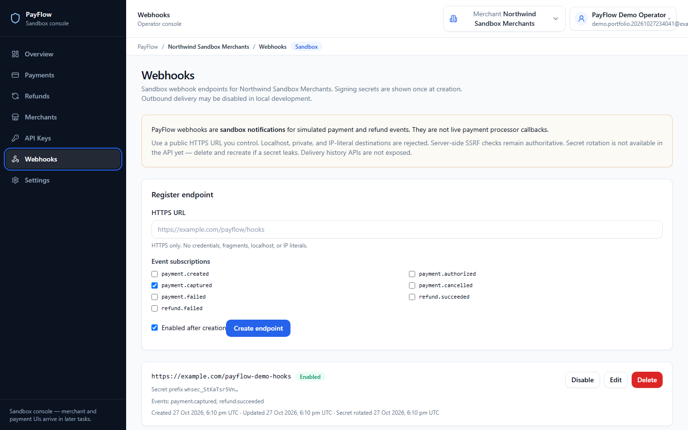

# PayFlow

**Simulated** merchant payments platform for portfolio and engineering review: accounts, API keys, authorize/capture/cancel flows, partial refunds, double-entry ledger, risk rules, analytics, signed webhooks, and a React operator console.

> **Educational / portfolio project.** PayFlow does **not** move real money, store card PANs/CVVs, or connect to live card networks or acquirers. All payment processing is sandbox simulation.

Local verification (2026-10-27) on Windows: **PASSED** — see [docs/LOCAL_VERIFICATION_REPORT.md](docs/LOCAL_VERIFICATION_REPORT.md).

---

## Why this exists

PayFlow shows production-inspired fintech backend design in a single modular monolith: money as integer minor units, a strict payment state machine, idempotent APIs, optimistic locking, transactional outbox → Kafka, and owner-scoped authorization — without pretending to be a PCI-certified processor.

It is intentionally **not** a thin CRUD demo.

---

## Key capabilities

| Capability | What it demonstrates |
|------------|----------------------|
| Identity & browser session | Register/login; access JWT in memory; HttpOnly refresh + CSRF |
| Merchants | Owner-scoped create/edit/switch; cross-tenant access returns **404** |
| Payments (INR, simulated) | Create → authorize → capture; cancel from eligible states |
| Refunds | Partial/full against `CAPTURED`; capacity checks; idempotent retries |
| Ledger | Append-only double-entry postings on capture/refund (no public ledger HTTP API) |
| Idempotency | `Idempotency-Key` on payment/refund create; fingerprint conflict → **409** |
| Risk | Rule evaluation on authorize (threshold / velocity / repeated failures) |
| Analytics | Merchant overview + daily series (UTC); sandbox activity only |
| API keys | `sk_test_` / `pk_test_`; secret returned once; HMAC-hashed at rest |
| Webhooks | HTTPS endpoint config, HMAC signing secret once; delivery off by default |
| Outbox / Kafka | Same-TX outbox; at-least-once publish/consume when enabled |

---

## Tech stack

| Area | Technology |
|------|------------|
| Backend | Java **21**, Spring Boot **4.1.1**, Spring Security, Spring Data JPA, Flyway, Bean Validation |
| Build | Maven Wrapper |
| Database | PostgreSQL 16 (source of truth for financial state) |
| Cache / rate limit | Redis 7 (not financial truth; auth rate limit fail-closed) |
| Messaging | Apache Kafka (optional Compose profile; workers off unless enabled) |
| Frontend | React **19**, TypeScript, Vite **7**, Tailwind **4**, TanStack Query |
| Tests | JUnit 5 + Testcontainers; Vitest; Playwright (local E2E) |
| API docs | OpenAPI / springdoc (enabled on `local` only) |
| Infra | Docker Compose; GitHub Actions CI; optional deploy Compose + HTTPS smoke |

---

## High-level architecture

Modular monolith: one Spring Boot process with package boundaries (`identity`, `merchants`, `payments`, `refunds`, `ledger`, `risk`, `analytics`, `webhooks`, `outbox`, `shared`).



- **PostgreSQL** — authoritative financial state + Flyway V1–V19 + outbox rows  
- **Redis** — rate limits / cache only  
- **Kafka** — domain events when publisher/consumer flags are on  

Details and diagrams: [docs/ARCHITECTURE.md](docs/ARCHITECTURE.md).

---

## Simulated payment lifecycle

Statuses (no live settlement):

`CREATED` → `AUTHORIZED` → `CAPTURED`  
also: `CREATED` → `FAILED` | `CANCELLED`; `AUTHORIZED` → `CANCELLED`



Refunds are a **separate** aggregate on `CAPTURED` payments (`PENDING` → `SUCCEEDED` | `FAILED`), not a payment-level `REFUNDED` status.

---

## Refunds and double-entry ledger

- Partial and full refunds with remaining-capacity enforcement under payment row lock.
- On successful **capture**: debit `PROCESSOR_CLEARING` / credit `MERCHANT_PAYABLE`.
- On successful **refund**: reverse that pair.
- Postings are append-only; unique `(source_type, source_id)` prevents duplicates. Covered by backend tests (`LedgerPostingTest`); there is **no** public ledger REST API.

---

## Idempotency and concurrency

- Clients send `Idempotency-Key` on payment and refund create.
- Same key + same fingerprint → original resource; conflicting body → **409**.
- Payment/refund transitions use optimistic locking (`@Version`); refund create locks the parent payment before capacity checks.

---

## Risk and analytics

- On authorize: merchant-scoped rules (`AMOUNT_THRESHOLD`, `PAYMENT_VELOCITY`, `REPEATED_FAILURES`) with FLAG / REVIEW / BLOCK.
- **Simulated risk engine** — not a production fraud product; no rule-management HTTP API yet.
- Analytics: owner JWT endpoints for overview and daily series in UTC (sandbox metrics, not bank balances).

---

## Authentication and security

| Surface | Mechanism |
|---------|-----------|
| Browser SPA | Access JWT **memory-only**; refresh HttpOnly cookie; CSRF on browser auth routes |
| JSON APIs | Bearer access JWT |
| Integrations | `Authorization: Bearer sk_test_…` (publishable `pk_test_` cannot call privileged APIs) |
| Tenancy | Owner checks; cross-merchant access → **404** |

Portfolio hardening notes (explicitly **not** PCI/SOC2): [docs/SECURITY.md](docs/SECURITY.md), [docs/API_AUTHENTICATION.md](docs/API_AUTHENTICATION.md).

---

## Local installation and startup

**Prerequisites:** Windows 11 (or compatible), JDK **21**, Node.js **22+/24**, Docker Desktop, Git. Maven via wrapper only.

```powershell
cd C:\Projects\PayFlow   # or your clone path
Copy-Item .env.example .env
. .\scripts\set-java-home.ps1
docker compose -f infra/docker-compose.yml --env-file .env up -d

cd backend
.\mvnw.cmd spring-boot:run "-Dspring-boot.run.profiles=local"

# separate terminal
cd frontend
npm install
npm run dev
```

| URL | Purpose |
|-----|---------|
| http://127.0.0.1:5173 | Operator console (Vite; binds IPv4 loopback) |
| http://localhost:8080/api/v1/system/ping | Backend liveness JSON |
| http://localhost:8080/actuator/health | Health (status only) |
| http://localhost:8080/swagger-ui.html | OpenAPI UI (`local` only) |

- Compose Postgres host port **5433** (avoids native `5432` conflicts).  
- JWT PEMs auto-generate under `backend/local-secrets/` on first local start (gitignored).  
- Never commit `.env`, PEMs, or `secrets/`.

Full guide: [docs/SETUP.md](docs/SETUP.md).

---

## Automated tests and CI

| Suite | Command | Last local verify |
|-------|---------|-------------------|
| Backend | `backend\mvnw.cmd clean verify` | **242** passed |
| Frontend unit | `npm run test` | **82** passed |
| Frontend gates | `typecheck`, `lint`, `build`, `npm audit --omit=dev` | PASS / 0 vulns |
| Playwright HTTP | `npm run test:e2e` | **3** passed |
| Playwright HTTPS Secure-cookie | `npm run test:e2e:https` (deploy HTTPS stack) | **1** passed |

GitHub Actions [`.github/workflows/ci.yml`](.github/workflows/ci.yml): Temurin 21 `clean verify` + Node 24 frontend gates on `main` / `feature/**` / PRs. Playwright E2E is **local-only** (not a CI job yet).

---

## Screenshots

Captured from a **local** sandbox session with a synthetic demo operator (no real PII, no secret-reveal dialogs). Prefixes such as `sk_test_…` / `whsec_…` are truncated metadata only.

| | |
|:--|:--|
| **Analytics overview** | **Merchant list** |
|  |  |
| **Merchant selector** | **Payment list** |
|  |  |
| **Captured payment + partial refund** | **Refunds entry (CAPTURED payments)** |
|  |  |
| **TEST API keys (metadata)** | **Webhook configuration** |
|  |  |

All figures show **simulated** INR activity in the operator console. Capture notes: [docs/images/README.md](docs/images/README.md).

---

## Known limitations

- Simulation only — no real cards, acquirers, or settlement.  
- Not PCI DSS, SOC 2, or GDPR certified.  
- Access JWTs are not denylisted on logout (refresh family is revoked).  
- Webhook HTTP delivery and Kafka workers default **off**; delivery is at-least-once when enabled.  
- No webhook secret rotation API; no risk rule-management APIs; REVIEW has no manual approval workflow.  
- No public ledger HTTP API.  
- Public cloud hosting is **out of scope** unless explicitly requested later.  
- Repository may remain **private** until you approve a public release.

Honest security/limits: [docs/SECURITY.md](docs/SECURITY.md). Local proof: [docs/LOCAL_VERIFICATION_REPORT.md](docs/LOCAL_VERIFICATION_REPORT.md).

---

## Repository layout

```
backend/               Spring Boot + Dockerfile
frontend/              React + Vite + Dockerfile/Nginx
infra/                 Docker Compose (dev + deploy overlays)
scripts/               Local helpers (JWT, deploy smoke, verification)
docs/                  Architecture, setup, security, verification
.github/workflows/     CI
AGENTS.md              Conventions for AI-assisted development
```

---

## Documentation map

| Doc | Purpose |
|-----|---------|
| [docs/SETUP.md](docs/SETUP.md) | Clone → run → test → shut down |
| [docs/ARCHITECTURE.md](docs/ARCHITECTURE.md) | Modules, state machine, outbox |
| [docs/SECURITY.md](docs/SECURITY.md) | Controls and explicit non-claims |
| [docs/API_AUTHENTICATION.md](docs/API_AUTHENTICATION.md) | JWT vs API keys |
| [docs/LOCAL_VERIFICATION_REPORT.md](docs/LOCAL_VERIFICATION_REPORT.md) | Machine verification evidence |
| [docs/ROADMAP.md](docs/ROADMAP.md) | Phases and acceptance criteria |
| [docs/DECISIONS.md](docs/DECISIONS.md) | ADRs |
| [docs/PUBLIC_READINESS.md](docs/PUBLIC_READINESS.md) | Public GitHub readiness audit |

---

## Safety

- Never commit `.env`, PEM keys, deploy secrets, DB dumps, or real PII.  
- Use sandbox/mock processing only (`PAYMENT_PROCESSOR_MODE=sandbox`).  
- Do not create paid cloud resources without an explicit decision.

## License

Private portfolio project until a license is chosen and approved. See [docs/PUBLIC_READINESS.md](docs/PUBLIC_READINESS.md) for options (no license file added yet).
