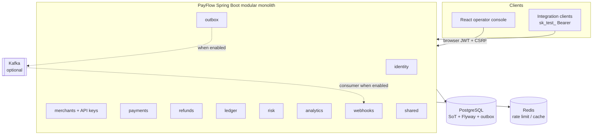
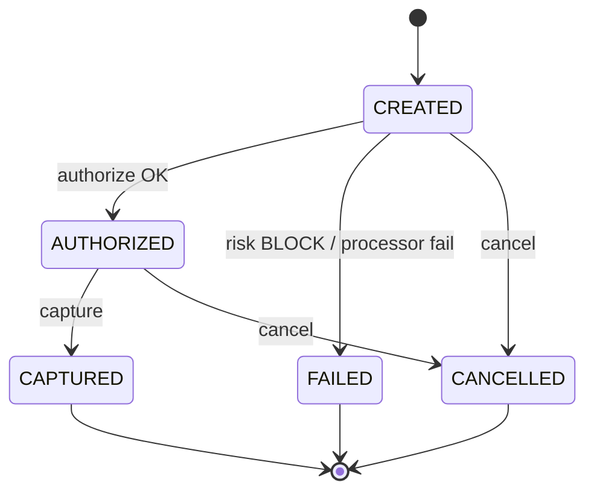
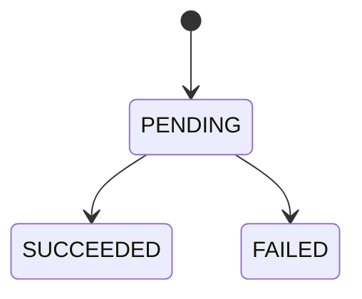
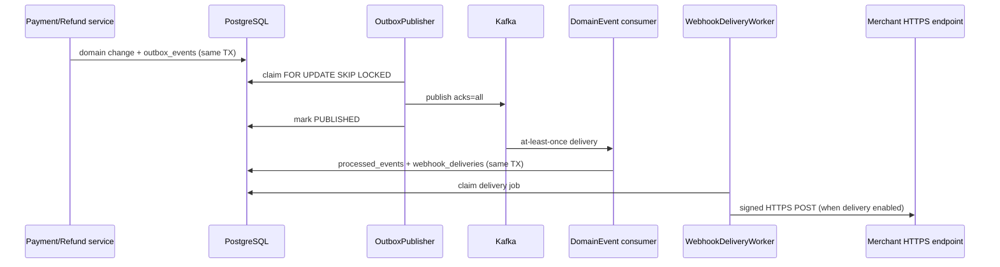

# PayFlow — Architecture

**Status:** Modular monolith with Phases 1–8 implemented locally; Phase 9 portfolio docs/local verify.  
**Last updated:** 2026-10-27  
**Honesty:** Simulation only — no real card networks or live funds. Diagrams match code on `feature/phase-9-portfolio`.

## 1. Overview

PayFlow is a **modular monolith**: one Spring Boot deployable with package-level domain boundaries. Shared infrastructure (JPA, security filters, outbox publisher) supports domains without splitting into networked microservices prematurely.



Frontend (React) talks to HTTP APIs. Integrations authenticate with secret API keys (`sk_test_…`).

## 2. Backend module boundaries

| Module (Java package) | Responsibility | Owns (conceptually) |
|--------|----------------|---------------------|
| `identity` | Users, passwords, JWT/refresh, browser session cookies | `User`, refresh tokens |
| `merchants` | Merchant profiles, membership, API keys | `Merchant`, `ApiKey` |
| `payments` | Payment commands, state machine, simulated processor | `Payment`, idempotency rows |
| `refunds` | Refund commands & capacity | `Refund`, refund idempotency |
| `ledger` | Double-entry postings (no public HTTP API) | `LedgerTransaction`, `LedgerEntry` |
| `webhooks` | Endpoints, signatures, delivery attempts | `WebhookEndpoint`, `WebhookDelivery` |
| `risk` | Rules evaluation on authorize | rules, assessments, auth attempts |
| `analytics` | Read-only SQL aggregates | overview / daily responses |
| `notifications` | Stub package for future notices | optional |
| `outbox` | Transactional outbox, Kafka publish/consume | `OutboxEvent`, `ProcessedEvent` |
| `shared` | Security filters, errors, money helpers | cross-cutting |

**Rule:** Domain modules do not reach into each other’s persistence internals. Prefer application services and published domain events.

## 3. Core entities and preliminary relationships

```
User 1──* MerchantMembership *──1 Merchant
Merchant 1──* ApiKey
Merchant 1──* Payment
Payment 1──* Refund
Payment 1──* LedgerEntry
Merchant 1──* WebhookEndpoint
WebhookEndpoint 1──* WebhookDelivery
Payment *──* IdempotencyRecord (scoped by merchant + key)
Merchant 1──* RiskRule
```

### Preliminary fields (conceptual)

**Money:** `amountMinor` (`bigint`), `currency` (`char(3)`). Never floating point.

**Payment:** `id`, `merchantId`, `amountMinor`, `currency`, `status`, `processorRef`, `failureCode`, `authorizedAt`, `capturedAt`, `version` (optimistic lock), `createdAt`, `updatedAt`.

**Refund:** `id`, `paymentId`, `merchantId`, `amountMinor`, `currency`, `status`, `idempotencyKey`, timestamps.

**ApiKey:** `id`, `merchantId`, `keyPrefix`, `secretHash`, `status`, `lastUsedAt`, `revokedAt`.

**IdempotencyRecord:** `merchantId`, `key`, `requestHash`, `responseRef` / stored response, `createdAt`, unique `(merchantId, key)`.

**OutboxMessage:** `id`, `aggregateType`, `aggregateId`, `eventType`, `payload`, `createdAt`, `publishedAt`.

Schema is owned by Flyway migrations **V1–V19** (`Hibernate ddl-auto=validate`).

## 4. Payment lifecycle (state machine)

### Statuses (implemented)

| Status | Meaning |
|--------|---------|
| `CREATED` | Persisted, not yet authorized |
| `AUTHORIZED` | Simulated auth hold succeeded |
| `CAPTURED` | Simulated capture succeeded — **not** bank settlement |
| `FAILED` | Terminal failure (decline / risk BLOCK) |
| `CANCELLED` | Cancelled from `CREATED` or `AUTHORIZED` |

**Design:** two-step authorize/capture. Status `VOIDED` is **not** used (cancellation is `CANCELLED`). See [DECISIONS.md](DECISIONS.md) ADR-017.



Refunds are a separate aggregate against `CAPTURED` payments only (no payment-level `REFUNDED` status):



Illegal transitions throw a domain error; persistence uses optimistic locking (`version`) plus payment-row locks on refund create to prevent lost updates under concurrency.

### Failure scenarios (engineering)

| Scenario | Handling |
|----------|----------|
| Validation error | 400; no payment row or row stays non-authorized |
| Auth failure | 401/403; no side effects |
| Idempotent replay (same payload) | 200 with original resource |
| Idempotent replay (different payload) | 409 Conflict |
| Risk block | Payment → `FAILED` with risk code; optional webhook |
| Processor decline | `FAILED` + decline code |
| Processor timeout | Leave retryable state or use attempt records; client retries with same idempotency key |
| Concurrent capture/void | Optimistic lock; one winner |
| Over-refund | Reject; no ledger post |

## 5. API authentication strategy

| Surface | Mechanism |
|---------|-----------|
| Integration API | `Authorization: Bearer sk_test_…` — prefix lookup + HMAC-SHA256(pepper, secret). Publishable `pk_test_…` cannot call privileged endpoints. LIVE prefix strings are recognized for classification only; **issuance is TEST mode**. |
| Operator console | Password login (BCrypt); access JWT in memory; opaque refresh (SHA-256 at rest) via HttpOnly cookie + CSRF on `/api/v1/auth/browser/**` |
| JSON token clients | `/api/v1/auth/login|refresh|logout` returning access + refresh tokens |
| Actuator | `prod` exposes health (+ liveness/readiness) with `show-details: never`; metrics ADMIN-gated; Nginx proxies exact health probes only |

**API key storage:** high-entropy secret, display once, store HMAC hash + public prefix. Revocation is immediate via status flag.

**Rate limiting:** Redis-backed counters on register/login/refresh; **fail-closed** if Redis is down.

## 6. Idempotency and concurrency

1. Client sends `Idempotency-Key` on create payment / create refund.
2. Server begins transaction; inserts idempotency row unique on `(merchant_id, operation, key)` (payments) or `(merchant_id, key)` for refunds.
3. On conflict, load existing record; compare request fingerprint; return stored outcome or 409.
4. Payments/refunds use `@Version` optimistic locking for state transitions; refund create locks the parent payment (`SELECT … FOR UPDATE`) before capacity checks.
5. Refundable capacity = payment `amount_minor` − sum of refunds in `PENDING` or `SUCCEEDED`, enforced in the same TX as refund insert/update. `FAILED` releases reserved capacity.

### Ledger posting (Phase 4)

| Event | Debit | Credit |
|-------|-------|--------|
| Successful capture | `PROCESSOR_CLEARING` | `MERCHANT_PAYABLE` |
| Successful refund | `MERCHANT_PAYABLE` | `PROCESSOR_CLEARING` |

Postings are append-only double-entry rows (`ledger_transactions` + two `ledger_entries`) in the **same** PostgreSQL transaction as the domain change. Unique `(source_type, source_id)` prevents duplicate postings. Failed capture/refund attempts create no ledger rows. Amounts are positive INR minor units only.

## 7. Data consistency approach

| Concern | Approach |
|---------|----------|
| Financial truth | PostgreSQL only |
| Cache | Redis optional; always safe to invalidate |
| Multi-row money updates | Single DB transaction |
| Domain events after commit | Transactional **outbox** table written in same TX as state change |
| Kafka publish | Async poller/publisher reads outbox; marks published |
| Consumers | Idempotent by event id / aggregate version |
| Read models (analytics) | Eventually consistent projections acceptable if labeled as such |

**Do not** update payment status in Redis and treat it as authoritative.

## 8. Event handling and webhook delivery

Topic `payflow.domain-events.v1`. Dead-letter topic `payflow.domain-events.v1.dlt`. Consumer group `payflow-domain-events-internal`.



1. Payment and refund services insert `outbox_events` in the **same** PostgreSQL transaction as the financial change. A failed outbox write rolls the money change back.
2. `OutboxPublisher` claims with `FOR UPDATE SKIP LOCKED` and a claim token, commits, then waits for a Kafka ACK (`acks=all`) before `PUBLISHED`. Stale tokens cannot finalize the row. Expired `PROCESSING` leases are reclaimable. Exhausted attempts become `FAILED`. Publisher stays off until `payflow.kafka.enabled` / outbox publisher flags are true.
3. `DomainEventKafkaListener` validates the envelope. Malformed events go to the DLT without a processed marker. The handler inserts `processed_events` and matching `webhook_deliveries` in one transaction. Redelivery of the same event id is a no-op.
4. `WebhookDeliveryWorker` (off unless `payflow.webhooks.delivery.enabled=true`) claims a job, commits, then POSTs. HMAC base is `{unixSeconds}.{eventId}.{body}` with header `X-PayFlow-Signature: v1=<hex>`. The socket connects only to the DNS-validated IP. TLS uses the JVM trust store, SNI, and hostname checks for the original host, and the HTTP `Host` header is that hostname. Redirects are permanent failures. 429/5xx/timeouts retry with backoff.

**Delivery guarantee:** at-least-once. Receivers must verify the signature and dedupe by event id. PayFlow does not claim exactly-once webhook delivery.

Registration APIs: `POST/GET/PATCH/DELETE /api/v1/merchants/{merchantId}/webhooks`. The signing secret is returned once.

Operations: Micrometer gauges for pending/failed/expired outbox and webhook rows, delivery success/failure counters, and publish/delivery latency. `GET /api/v1/internal/events/health` and `/actuator/metrics` require JWT role `ADMIN`. `EventRecoveryService` can requeue terminal `FAILED` rows without an HTTP mutation API.

## 9. Security considerations

- No PAN/CVV storage; mock `pm_tok_...` or last4/brand only.
- Secrets in env / secret store; `.env` gitignored.
- HTTPS in deployed environments (local HTTP acceptable).
- Principle of least privilege for DB users when Compose hardens.
- Parameterized queries via JPA; validate all inputs (Bean Validation).
- Structured logs without secrets or full API keys.
- CORS locked to known frontend origins per environment.
- Dependency updates via Dependabot/Renovate later.

## 10. Testing strategy

| Layer | Tools | Focus |
|-------|-------|-------|
| Unit | JUnit 5, Mockito | State machine, money, idempotency hashing, signature |
| Integration | Testcontainers (Postgres, Redis, Kafka as needed) | Repositories, Flyway, API slices |
| API | MockMvc / WebTestClient | Auth, validation, status codes |
| Frontend | Vitest + React Testing Library | Auth, merchants, analytics, payments/refunds, API keys, webhooks |
| E2E | Playwright Chromium (local) | Auth/session, merchant isolation, payment lifecycle; optional HTTPS Secure-cookie |
| Manual | Compose stack | Smoke on Windows + Docker |

CI (GitHub Actions): backend `mvnw clean verify` + frontend typecheck/lint/test/build/audit. Playwright is local-only for now. Local verify evidence: [LOCAL_VERIFICATION_REPORT.md](LOCAL_VERIFICATION_REPORT.md).

## 11. Observability

- Structured logs for publish and delivery outcomes. Secrets and payloads are not logged.
- Actuator `/health`, `/health/liveness`, `/health/readiness` are public (status only). `/info` may be public on local; disabled on `prod`. `/actuator/metrics` requires `ADMIN` and is **not** proxied by Nginx.
- Gauges refresh on an interval (`payflow.operations.metrics-refresh-ms`, default 15s). Labels are status or outcome only.

## 12. Deployment topology (local)

Docker Compose: dev infra `infra/docker-compose.yml` (published Postgres/Redis); deploy stack `infra/docker-compose.deploy.yml` (frontend-only host port; backend/DB/Redis internal). Optional Kafka via Compose profile.

Resource caps should be set so a 16 GB machine remains usable.

## 13. Implementation notes

| Area | Reality |
|------|---------|
| App | Spring Boot **4.1.1**, Java 21, Maven Wrapper |
| Identity | Register/login, RS256 JWT, hashed refresh rotation, `/users/me` |
| Merchants | Owner-scoped CRUD; memberships table ready for future MEMBER role |
| API keys | `sk_test_` / `pk_test_`; secret HMAC hash; `/integrations/me` diagnostic |
| Schema | Flyway V1–V19; `schema_phase = phase-6` |
| Hibernate | `ddl-auto=validate` |
| Security | Public auth + ping + health; JWT vs API-key Bearer classification; internal ops require `ADMIN` |
| OpenAPI | springdoc **3.1.1**; Swagger UI local-only |
| Kafka | Optional. Publisher and consumer stay off until `payflow.kafka.enabled=true` (and the matching publisher/consumer flags). Bootstrap `localhost:9094` when Compose profile `kafka` is up |
| Ports | Postgres **5433**, Redis **6379**, Kafka **9094**, app **8080** |

See also [API_AUTHENTICATION.md](API_AUTHENTICATION.md) and [SECURITY.md](SECURITY.md).

## 14. Risk evaluation (Phase 6)

Merchant-scoped rules (`AMOUNT_THRESHOLD`, `PAYMENT_VELOCITY`, `REPEATED_FAILURES`) with actions FLAG/REVIEW/BLOCK. Authorize path: lock payment → lock merchant → record attempt → evaluate → persist assessment/matches → apply payment/outbox in one TX. Decision precedence BLOCK > REVIEW > FLAG > ALLOW; scores clamped to `[0, 100]`. REVIEW holds payment in `CREATED` (no approval API). BLOCK → `FAILED` (`risk_blocked`) with one failure outbox event. Assessments and match snapshots are immutable. Velocity uses authorize attempts, not create-time. Not a production fraud system.

## 15. Merchant analytics (Phase 6)

Read-only JWT OWNER endpoints: `GET /api/v1/merchants/{id}/analytics/overview` and `.../daily`. UTC calendar dates (inclusive) map to half-open instants; default last 30 days; max 366. Status counts use current status among payments created in-window; amounts use `captured_at` / SUCCEEDED `completed_at` / risk `evaluated_at`. Live SQL aggregates (no Redis). Sandbox activity only — not settled balances.

## 16. React operator console (Phase 7)

Vite 7 + React 19 + TypeScript + Tailwind 4 SPA under `frontend/`. Axios client proxies `/api/v1` via Vite. Auth: access JWT in memory; refresh HttpOnly cookie + CSRF on `/api/v1/auth/browser/**`; concurrent refresh single-flight. Merchant selection persists merchant id only (validated against owned list); TanStack Query keys scoped by merchant and cleared on switch/logout. Surfaces: analytics (real backend aggregates), simulated payments/refunds with stable idempotency keys, API-key and webhook management with one-time secret reveal (not query-cached).

## 17. Explicit honesty

Phases 1–8 are **implemented** and locally verified on `feature/phase-9-portfolio` (see [LOCAL_VERIFICATION_REPORT.md](LOCAL_VERIFICATION_REPORT.md)). Phase 9 covers portfolio docs / local HTTPS / readiness — **not** public cloud hosting.

Still not built or not claimed: risk rule-management APIs, manual REVIEW approval workflow, webhook secret rotation API, CI-hosted Playwright, public production deploy. Kafka publish and outbound webhook HTTP default to **off**. Delivery is at-least-once. Access JWTs are not denylisted on logout. Significant changes must be recorded in [DECISIONS.md](DECISIONS.md).
